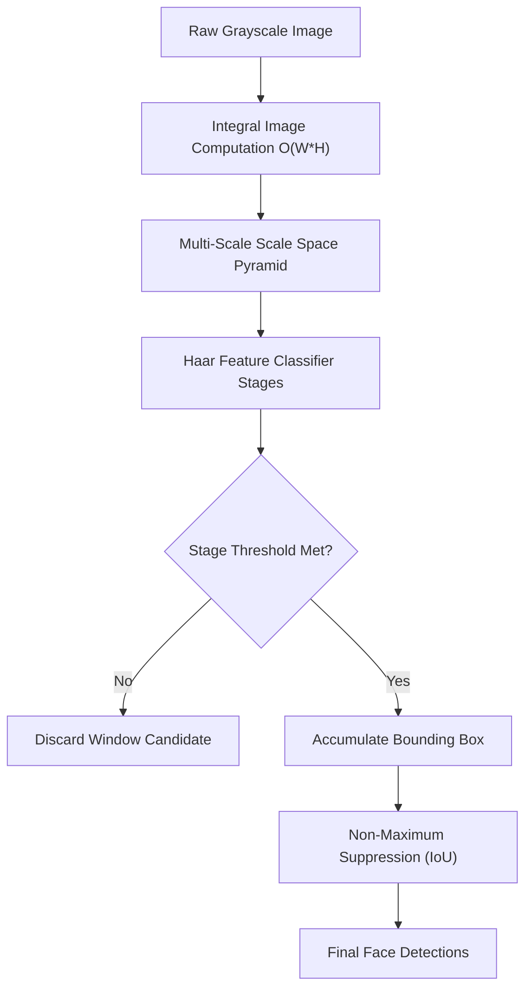

# Architecture Design: Face Detection App

## 1. System Overview
The `Face-Detection-App` implements a classical Viola-Jones Haar-like cascade detection pipeline in modern C++17. The system avoids external runtime dependencies by using an integral image representation, multi-scale sliding window pyramid traversal, and Non-Maximum Suppression (NMS) clustering.

## 2. Component Architecture
- **`IntegralImage`**: Computes standard area tables where each pixel $(x,y)$ contains $\sum_{x'\le x, y'\le y} I(x',y')$. Evaluates arbitrary rectangular sums in $O(1)$ constant time:
  $$\text{Sum}(D) = I(x_4, y_4) + I(x_1, y_1) - I(x_2, y_2) - I(x_3, y_3)$$
- **`HaarCascadeClassifier`**: Cascaded decision tree stages with two-rectangle, three-rectangle, and four-rectangle differential kernel masks.
- **`DetectionEngine`**: Handles window scaling ($s \in [1.0, 4.0]$, step $\Delta s = 1.25$), stride shifts ($\Delta x = \Delta y = 2\text{px}$), and bounding box projection.
- **`NonMaximumSuppression`**: Eliminates redundant overlapping bounding boxes using Intersection-over-Union ($\text{IoU} \ge 0.30$) clustering and score weighting.

## 3. Concurrency & Performance
- Integral image generation runs in a single deterministic pass.
- Windows across independent scale factors can be evaluated concurrently across thread pools.
- Early exit rejection discards $>90\%$ of background windows in the first two cascade stages.
