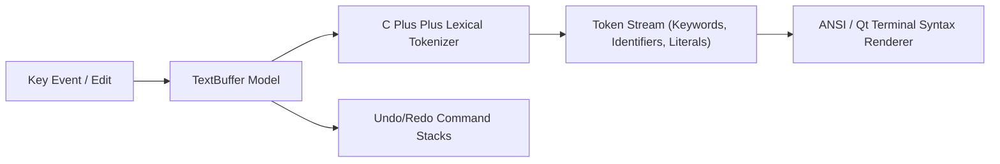

# Architecture Design: C Plus Plus Code Editor

## 1. System Overview
The `Java-Code-Editor` is a 100% native C Plus Plus text editor engine designed to handle large source code buffers with lexical syntax tokenization, cursor positioning, and undo/redo revision histories.

## 2. Component Architecture
- **`TextBuffer`**: Manages line-indexed string arrays, cursor offsets $(row, col)$, line insertions, deletions, and boundary clamping.
- **`CppSyntaxHighlighter`**: Deterministic state machine categorizing tokens into:
  - Keywords: `class`, `public`, `private`, `protected`, `template`, `typename`, `constexpr`, `const`, `auto`, `int`, `double`, `void`, `return`, `namespace`, `using`, etc.
  - Literals: Numeric literals, string literals with escape sequences (`"..."`), character literals (`'.'`).
  - Comments: Single-line (`//`) and multi-line (`/* ... */`) blocks.
  - Preprocessor directives: `#include`, `#define`, `#pragma`, `#ifdef`.
  - Operators & Delimiters: `{ } ( ) [ ] ; , . = + - * / :: ->`
- **`CommandHistory`**: Implements the Command Pattern using twin `std::vector<EditCommand>` stacks (`m_undoStack`, `m_redoStack`) providing infinite undo and redo.
- **`SyntaxRenderer`**: Translates classified lexical token streams into ANSI terminal escape sequences or GUI syntax styles.

## 3. Performance & Memory Guarantees
- Avoids large copies through `std::string_view` window slicing.
- Tokenization is executed line-by-line on dirty lines rather than re-tokenizing the entire buffer on single keystrokes.
