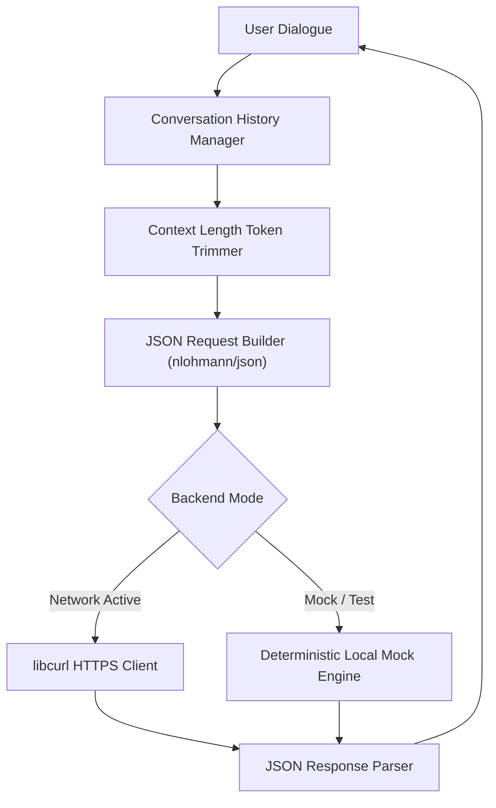

# Architecture Design: AI Chatbot Tool

## 1. System Overview
The `AI-Chatbot-Tool` provides an extensible, production-grade conversational client interface for OpenAI-compatible RESTful inference endpoints with dialogue history management, sliding-window token trimming, and deterministic offline mock execution.



## 2. Component Architecture
- **`ConversationManager`**: Maintains structured message turns:
  ```cpp
  struct Message {
      std::string role;    // system, user, assistant
      std::string content;
      int64_t timestamp;
  };
  ```
- **`TokenEstimator & Trimmer`**: Estimates token consumption using character heuristic ratios ($\sim 4$ chars per token) and prunes oldest non-system turns when history exceeds maximum context thresholds ($N_{max}$).
- **`HttpClient`**: Encapsulates libcurl with timeouts (connect 5s, read 15s), custom headers (`Authorization: Bearer <KEY>`, `Content-Type: application/json`), and error handling.
- **`MockInferenceEngine`**: Deterministic offline engine producing rule-based responses matching API schemas for CI/CD test automation without internet access or API credentials.

## 3. Security
- Secrets (`OPENAI_API_KEY`) are read strictly from environment variables at runtime.
- Never logged or serialized into error diagnostics.
