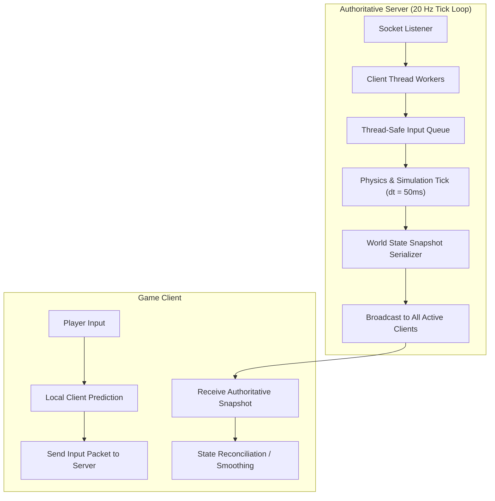

# Architecture Design: Multiplayer LAN Game

## 1. System Overview
The `Multiplayer-LAN-Game` provides an authoritative server-client multiplayer architecture operating over local TCP/UDP networks with a deterministic 20 Hz server simulation tick loop, packet serialization, and client prediction.

## 2. Component Architecture
- **`GameProtocol`**: Binary packet serializer supporting message opcodes:
  - `OP_JOIN` / `OP_JOIN_ACK`: Handshake and assign player ID.
  - `OP_INPUT`: Client movement vectors $(dx, dy)$ and sequence numbers.
  - `OP_SNAPSHOT`: Server world state containing entity coordinates, velocities, and scores.
  - `OP_LEAVE`: Graceful disconnect notice.
- **`GameServer`**:
  - Worker thread handling non-blocking network socket polling.
  - Simulation thread updating positions with arena boundary clamping ($[-100, +100]$).
  - Mutex-protected world state with copy-on-write broadcasting.
- **`GameClient`**:
  - Maintains predicted client state and interpolates towards authoritative snapshots to mask network jitter.

## 3. Concurrency Model
- Separate threads for network socket I/O and server physics loop to guarantee invariant 20 Hz tick rates irrespective of client latency.
