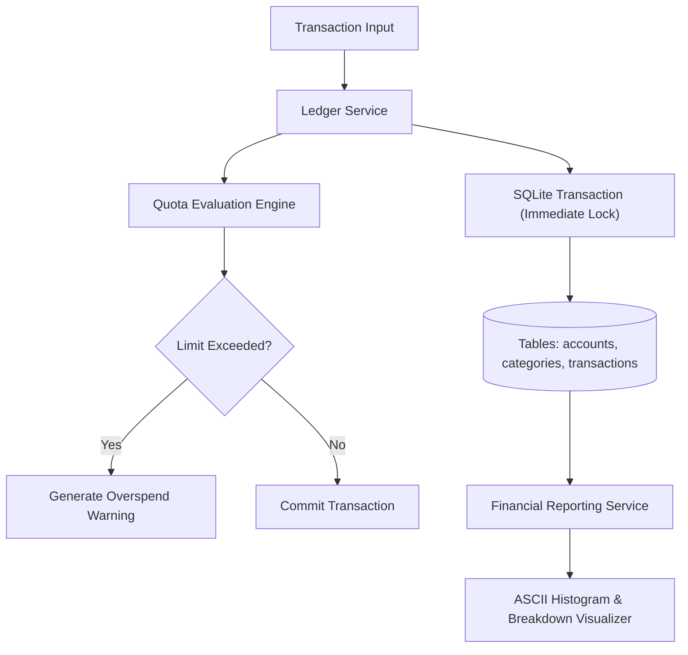

# Architecture Design: Budget Tracker App

## 1. System Overview
The `Budget-Tracker-App` is an enterprise personal finance and ledger engine backed by an ACID-compliant SQLite3 relational database, financial integer-cent arithmetic, category quota enforcement, and ASCII chart reporting.

## 2. Component Architecture
- **`BudgetDatabase`**:
  - Uses SQLite3 C API wrapped with RAII statements (`sqlite3_stmt*`).
  - Tables: `categories` (budget limits), `transactions` (type, category_id, amount_cents, date, memo).
  - Enforces `basePriceCents` integer precision to avoid IEEE 754 floating-point inaccuracies.
- **`BudgetManager`**:
  - Handles business rules: recording income/expenses, calculating monthly spends against quotas.
  - Produces real-time spending status percentages.
- **`ChartGenerator`**:
  - Renders horizontal text-based ASCII bar charts visualizing proportional expenses per category across user-selected time horizons.

## 3. ACID Guarantees
- Every transaction insertion is executed within `BEGIN IMMEDIATE TRANSACTION` to prevent read-after-write skew.
