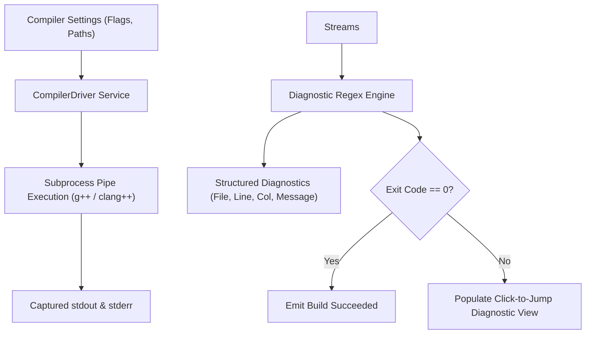

# Architecture Design: C Plus Plus Compiler UI & Toolchain Driver

## 1. System Overview
The `Java-Compiler-UI` is a 100% native C Plus Plus process orchestration engine designed to drive external compiler toolchains (such as `g++` or `clang++`), pipe real-time diagnostic streams, parse compiler error diagnostics with regex, and manage compilation tasks asynchronously.

## 2. Component Architecture
- **`ProcessRunner`**:
  - Executes compiler binaries with parameter arrays (never via raw shell string concatenation) to prevent command injection.
  - Captures output pipes asynchronously with watchdog timeouts to prevent runaway compiler hanging.
- **`DiagnosticParser`**:
  - Employs regex matching for standard diagnostic formats:
    - GCC/Clang: `(?<file>[^:]+):(?<line>\d+):(?<col>\d+):\s+(?<severity>error|warning|note):\s+(?<msg>.*)`
    - MSVC: `(?<file>[^(]+)\((?<line>\d+)\):\s+(?<severity>error|warning)\s+(?<code>[A-Za-z0-9]+):\s+(?<msg>.*)`
  - Creates structured diagnostic records enabling IDE navigation.
- **`CompilerManager`**: Coordinates multiple build targets, environment discovery, and compiler configuration profiles.

## 3. Reliability & Safety
- Full isolation of process lifecycles with graceful termination (`SIGTERM` / `TerminateProcess`) on timeout.
