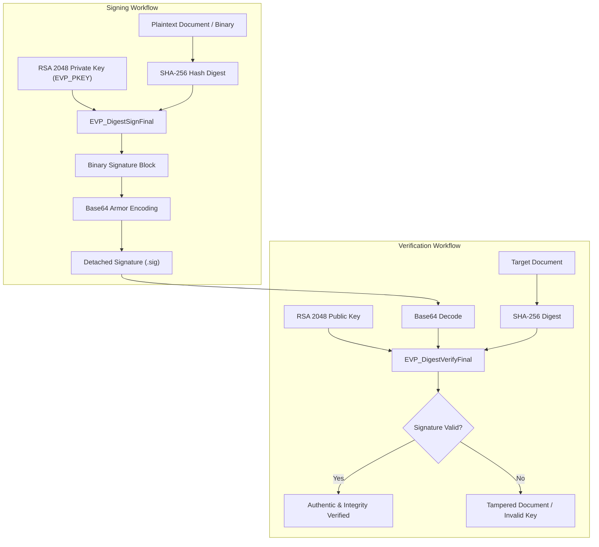

# Architecture Design: Digital Signature Maker

## 1. System Overview
The `Digital-Signature-Maker` provides an asymmetric cryptographic suite utilizing OpenSSL EVP APIs to generate 2048-bit RSA keypairs, compute SHA-256 digests, and produce verifiable cryptographic digital signatures with Base64 armor encoding.

## 2. Component Architecture
- **`CryptoEngine`**:
  - Uses modern OpenSSL EVP APIs (`EVP_PKEY_CTX_new_id`, `EVP_PKEY_keygen`, `EVP_DigestSignInit`, `EVP_DigestVerifyInit`).
  - Strict RAII memory management using custom Deleters (`EVP_PKEY_free`, `EVP_MD_CTX_free`, `BIO_free_all`).
- **`Base64Codec`**:
  - High-performance binary-to-ASCII and ASCII-to-binary armored representation.
- **`SignatureVerifier`**:
  - Detects single-bit alterations or document truncation with constant-time verification.

## 3. Security Standards
- Cryptographic private keys are generated with secure hardware randomness via `RAND_bytes`.
- Zero key material leaks; memory buffers are securely sanitized prior to deallocation.
