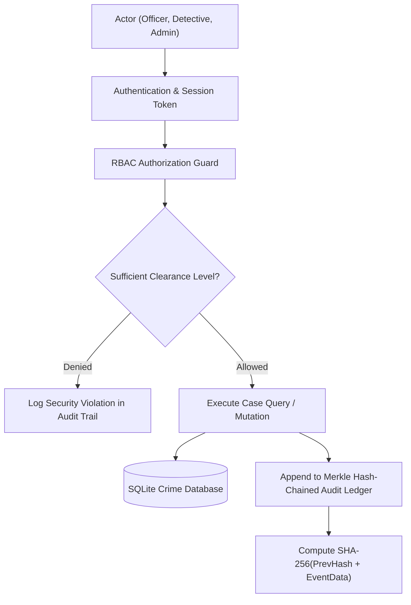

# Architecture Design: Crime Record Manager

## 1. System Overview
The `Crime-Record-Manager` is a fictional law enforcement record platform demonstrating Role-Based Access Control (RBAC), multi-level authorization, and a Merkle hash-chained tamper-evident audit ledger backed by SQLite3.

## 2. Component Architecture
- **`RBACManager`**:
  - Roles: `Officer` (view basic records, log incidents), `Detective` (manage active cases, suspects, evidence), `Administrator` (user management, audit review).
  - Clearance levels (1 to 5) guarding sensitive case files.
- **`AuditChain`**:
  - Implements a cryptographic append-only Merkle chain.
  - Every log entry stores `prev_hash`, `timestamp`, `actor_id`, `action`, `payload`, and `entry_hash = SHA256(prev_hash || payload)`.
  - Full-ledger integrity validation detects retrospective tampering or unauthorized record deletions.
- **`CrimeDatabase`**:
  - SQLite3 relational tables with foreign key integrity.

## 3. Data Integrity & Privacy
- All sample records are strictly fictional.
- Passwords stored as salted cryptographic hashes.
