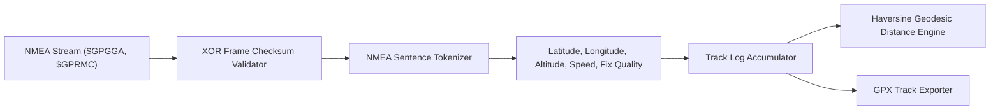

# Architecture Design: GPS Location Tracker

## 1. System Overview
The `GPS-Location-Tracker` processes raw NMEA-0183 serial byte streams, validates XOR checksum integrity, decodes `$GPGGA` and `$GPRMC` positioning sentences, computes geodesic distances using the Haversine formula, and exports track logs to standard GPX XML format.

## 2. Component Architecture
- **`NMEAParser`**:
  - Verifies framing characters (`$`, `*`, `\r\n`).
  - Computes byte-wise XOR parity from `$` to `*` and compares against the hex checksum.
  - Extracts ISO coordinates (degrees and decimal minutes) and converts to signed decimal degrees:
    $$\text{Degrees} = D + \frac{M}{60.0}$$
- **`GeodesyEngine`**:
  - Computes great-circle distance between consecutive coordinate pairs:
    $$a = \sin^2\left(\frac{\Delta\phi}{2}\right) + \cos(\phi_1)\cos(\phi_2)\sin^2\left(\frac{\Delta\lambda}{2}\right)$$
    $$c = 2 \cdot \text{atan2}(\sqrt{a}, \sqrt{1-a}), \quad d = R \cdot c \quad (R = 6371.0\,\text{km})$$
  - Calculates initial navigational bearing.
- **`GPXExporter`**:
  - Generates GPX 1.1 compliant XML documents with track segments (`<trkseg>`) and track points (`<trkpt>`).

## 3. Resilience & Modes
- Full simulation mode allows testing without real GPS hardware or COM ports.
- Malformed or corrupted NMEA packets are rejected cleanly without parser state degradation.
