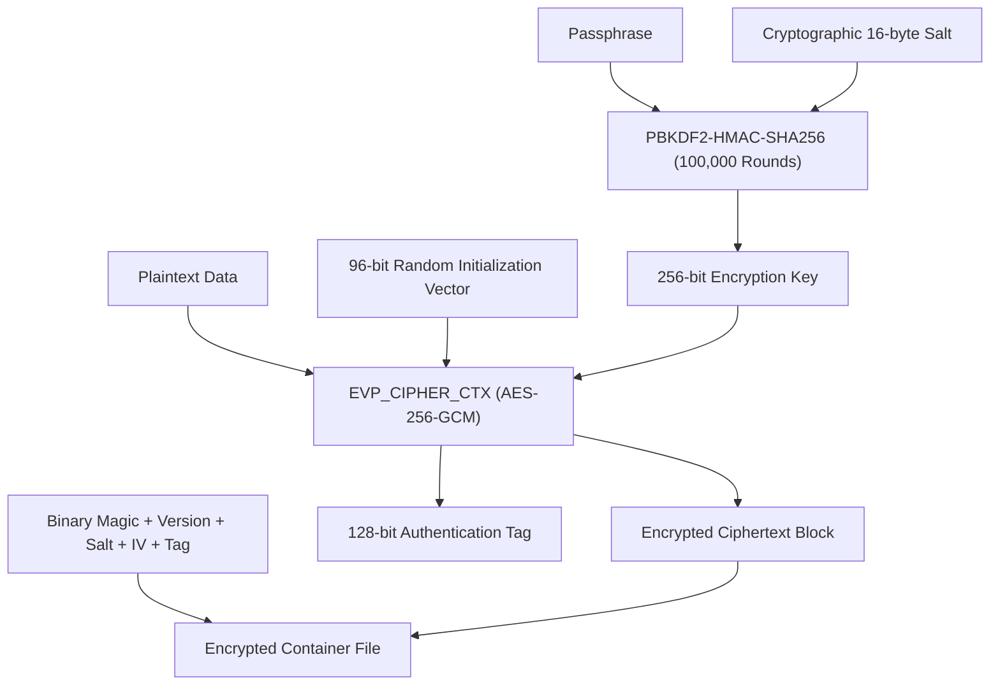

# Architecture Design: Encryption-Decryption Tool

## 1. System Overview
The `Encryption-Decryption-Tool` is an authenticated file encryption and decryption engine implementing AES-256-GCM (Galois/Counter Mode) via OpenSSL EVP with PBKDF2 key derivation and binary container headers.



## 2. Component Architecture
- **`CryptoEngine`**:
  - Key derivation: `PKCS5_PBKDF2_HMAC` using SHA-256 with 100,000 iterations and 16-byte random salt.
  - AEAD encryption: `EVP_aes_256_gcm()` generating a 12-byte IV and 16-byte auth tag.
  - Decryption verifies the tag before releasing decrypted plaintext, preventing chosen-ciphertext attacks.
- **`ContainerCodec`**:
  - Encapsulates binary file format:
    ```
    [4B Magic: 'AEAD'] [1B Version: 0x01] [16B Salt] [12B IV] [16B Tag] [N Bytes Ciphertext]
    ```
- **`SecureMemory`**:
  - Overwrites key and passphrase buffers with zeros via `OPENSSL_cleanse` before releasing allocations.

## 3. Security Guarantees
- Rejects tampered ciphertexts, truncated files, or modified tags with strict cryptographic authentication failures.
