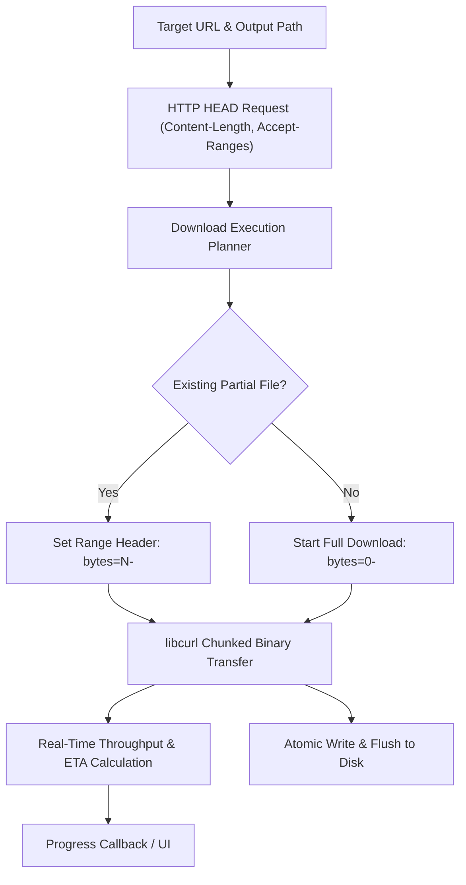

# Architecture Design: Video & Stream Downloader

## 1. System Overview
The `YouTube-Video-Downloader` is a general-purpose, resumable HTTP/HTTPS binary stream downloader built with libcurl and multithreading. It strictly provides an adapter architecture for lawful content and enforces platform Terms of Service by omitting stream extraction or DRM circumvention logic.

## 2. Component Architecture
- **`DownloadEngine`**:
  - Encapsulates libcurl multi/easy handles.
  - Supports pause, resume, and HTTP 206 Partial Content handling.
- **`BandwidthMeter`**:
  - Calculates moving average download speed (bytes/sec) and estimates time of arrival (ETA).
- **`Sanitizer`**:
  - Sanitizes destination filenames, eliminating path traversal attempts (`../`) and illegal filesystem characters.
- **`ComplianceNotice`**:
  - Emits clear legal notices concerning platform terms and content copyright permissions.

## 3. Reliability
- Automatically recovers from intermittent network drops using exponential backoff retry policies.
