# Architecture Design: Cloud Storage Client-Server

## 1. System Overview
The `Cloud-Storage-App` is a distributed, multi-threaded client-server file storage application featuring token-based authentication, chunked multipart uploads, SHA-256 block reconciliation, and metadata persistence in SQLite3.

```mermaid
flowchart TD
    subgraph Client ["Storage Client"]
        File["Local Source File"] --> Splitter["Chunk Splitter (1 MB Chunks)"]
        Splitter --> ChunkHasher["Compute Chunk SHA-256"]
        ChunkHasher --> NetworkClient["Send TCP Framing Packets"]
    end

    subgraph Server ["Storage Server"]
        NetworkServer["TCP Listener Worker Threads"] --> AuthGuard["Token Authentication Check"]
        AuthGuard --> ChunkReceptor["Chunk Assembly Pipeline"]
        ChunkReceptor --> HashVerify["Verify Chunk SHA-256 Integrity"]
        HashVerify --> Disk["Persist to Dedicated Object Store Directory"]
        Disk --> Metadata[("SQLite File Metadata Database")]
    end
```

## 2. Component Architecture
- **`StorageProtocol`**:
  - Binary/Text framing protocol over TCP:
    - `AUTH <token>` -> `AUTH_OK`
    - `UPLOAD_INIT <filename> <size> <total_chunks>`
    - `UPLOAD_CHUNK <file_id> <chunk_index> <chunk_size> <sha256> [binary payload]`
    - `UPLOAD_FINALIZE <file_id>`
    - `DOWNLOAD <file_id>`
- **`StorageServer`**:
  - Multi-threaded worker pool accepting client connections.
  - Validates session tokens on every packet before routing.
  - Prevents path traversal vulnerabilities (`..`) by enforcing isolated workspace roots.
- **`MetadataStore`**:
  - SQLite3 relational engine tracking file ownership, timestamps, block counts, and reconciliation states.

## 3. Resilience
- Interrupted multipart uploads can be resumed by querying server chunk bitmaps without re-uploading complete files.
