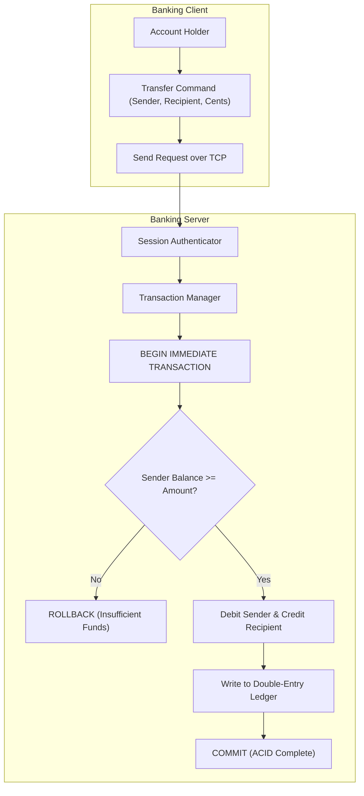

# Architecture Design: Online Banking System

## 1. System Overview
The `Online-Banking-System` is an educational, distributed client-server core banking simulator featuring double-entry ledger bookkeeping, SQLite3 immediate ACID transactions, atomic fund transfers, and overdraft rollback protection.

## 2. Component Architecture
- **`BankingDatabase`**:
  - Stores monetary quantities exclusively as 64-bit integer minor units (`balance_cents`) to eliminate floating-point drift.
  - Schema: `accounts` (account_number, pin_hash, balance_cents, status), `ledger_entries` (entry_id, from_account, to_account, amount_cents, timestamp, balance_after).
- **`TransferEngine`**:
  - Atomic transfer execution within `BEGIN IMMEDIATE TRANSACTION`.
  - Immediate write locks eliminate race conditions and double-spending across concurrent requests.
- **`BankingProtocol`**:
  - Sockets-based message protocol with authenticated session tokens and idempotent request tracking.

## 3. Integrity Guarantees
- System-wide invariant: Total monetary supply across all accounts remains strictly constant during transfers ($S_{total} = \text{const}$).
