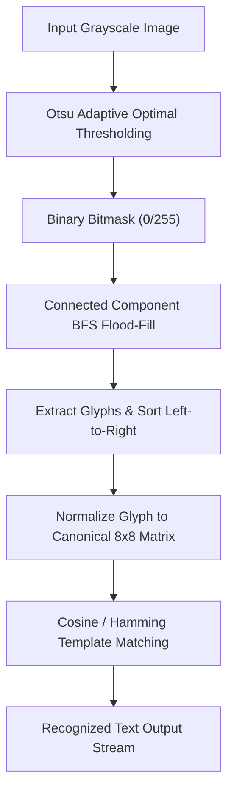

# Architecture Design: OCR Scanner Tool

## 1. System Overview
The `OCR-Scanner-Tool` is an image preprocessing and optical character recognition pipeline implementing Otsu adaptive binarization, connected-component BFS flood-fill segmentation, and normalized glyph template matching.

## 2. Component Architecture
- **`OtsuBinarizer`**:
  - Computes global image histogram (256 bins).
  - Maximizes inter-class variance $\sigma_B^2(t) = \omega_0(t)\omega_1(t)[\mu_0(t) - \mu_1(t)]^2$ across all thresholds $t \in [0, 255]$ in $O(N)$ time.
- **`GlyphSegmenter`**:
  - Employs 8-connected breadth-first search (BFS) flood-fill to discover discrete character components.
  - Computes bounding boxes $(x, y, w, h)$ and filters noise components below minimum area thresholds.
  - Sorts glyphs topologically (reading order: top-to-bottom, left-to-right).
- **`TemplateMatcher`**:
  - Canonical 8x8 pixel feature vector comparison against known alphanumeric glyph definitions.
  - Employs minimum Hamming distance and normalized correlation for classification.

## 3. Reliability & Fallbacks
- Completely self-contained algorithm; operates without external runtime neural network dependencies or heavy native binaries.
