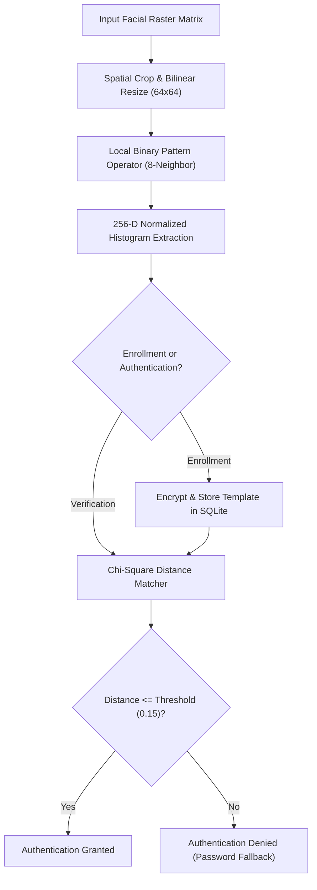

# Architecture Design: Face Login Authentication

## 1. System Overview
The `Face-Login-Authentication` system is a biometric verification engine implementing Local Binary Patterns (LBP) texture descriptors, 256-dimensional spatial histogram extraction, and Chi-Square metric distance classification with password authentication fallback.

## 2. Component Architecture
- **`LBPFeatureExtractor`**:
  - Computes 8-neighbor circular LBP codes for pixel $(x, y)$:
    $$LBP(x_c, y_c) = \sum_{p=0}^7 s(i_p - i_c) \cdot 2^p, \quad s(z) = \begin{cases} 1 & z \ge 0 \\ 0 & z < 0 \end{cases}$$
  - Accumulates spatial histogram bins normalized by total pixel count.
- **`ChiSquareClassifier`**:
  - Evaluates histogram dissimilarity metric:
    $$\chi^2(H_1, H_2) = \frac{1}{2} \sum_{i=1}^B \frac{(H_1(i) - H_2(i))^2}{H_1(i) + H_2(i)}$$
  - Distinguishes authentic enrolled users from imposters based on calibrated thresholding ($\tau = 0.15$).
- **`AuthVault`**:
  - Stores biometric feature vectors encrypted at rest.
  - Enforces account lockout rules and credential-based fallback.

## 3. Threat Model & Known Limitations
- The system explicitly documents resistance to monotonic illumination changes, but notes vulnerability to 2D photograph presentation attacks (spoofing) in the absence of active depth sensors or liveness blink detection.
