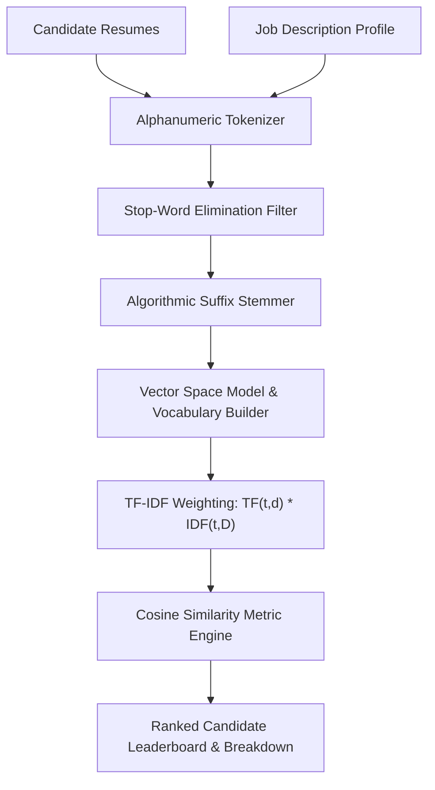

# Architecture Design: Resume Ranker & NLP Engine

## 1. System Overview
The `Resume-Ranker-App` is a natural language processing text analysis engine utilizing lexical tokenization, stop-word elimination, suffix stemming, and the Term Frequency-Inverse Document Frequency (TF-IDF) vector space model with Cosine similarity matching.

## 2. Component Architecture
- **`TextProcessor`**:
  - Lowercases and cleans text input using standard ASCII/Unicode transformations.
  - Filters common English functional stop-words (`the`, `is`, `at`, `which`, `on`).
  - Suffix stemmer reduces inflected word variants to common root stems (`developer`, `developing`, `development` -> `develop`).
- **`VectorSpaceModel`**:
  - Computes document term frequencies:
    $$\text{TF}(t, d) = \frac{f_{t,d}}{\sum_{t' \in d} f_{t',d}}$$
  - Computes inverse document frequency across resume collection:
    $$\text{IDF}(t, D) = \ln\left(1 + \frac{|D|}{1 + |\{d \in D : t \in d\}|}\right) + 1$$
- **`CosineRanker`**:
  - Calculates inner product similarity between job description vector $\vec{q}$ and candidate vector $\vec{d}$:
    $$\text{Sim}(\vec{q}, \vec{d}) = \frac{\vec{q} \cdot \vec{d}}{\|\vec{q}\| \|\vec{d}\|}$$

## 3. Ethics & Algorithmic Fairness
- Explicitly documents bias disclaimers: lexical TF-IDF metrics rank text overlap, not human competence or protected demographic traits.
