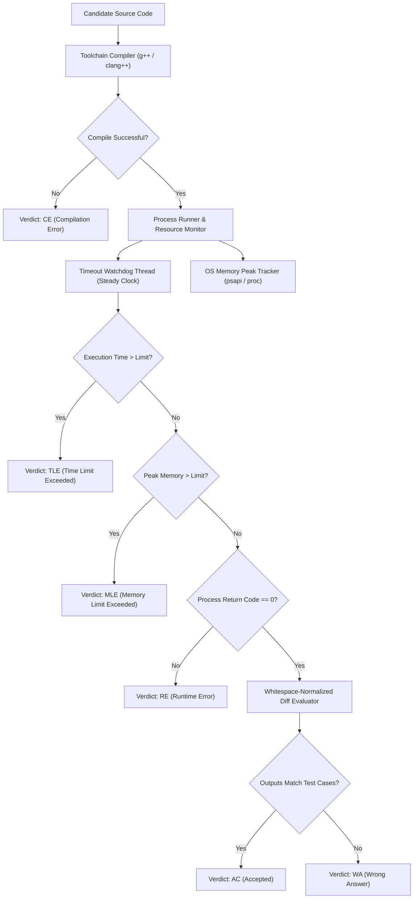

# Architecture Design: Coding Test Platform & Judge

## 1. System Overview
The `Coding-Test-Platform` is an automated code execution and evaluation judge orchestrating compilation, subprocess execution, wall-clock watchdog timeouts (TLE), memory usage tracking (MLE), and whitespace-agnostic output validation (AC/WA).

## 2. Component Architecture
- **`ProcessHarness`**:
  - Spawns subprocesses via OS process APIs (`CreateProcess` on Windows, `fork`/`exec` on Linux).
  - Redirects standard streams via non-blocking pipes.
- **`ResourceWatchdog`**:
  - Enforces strict milliseconds timeout using `std::chrono::steady_clock`.
  - Samples memory consumption (`K32GetProcessMemoryInfo` on Windows).
- **`VerdictEvaluator`**:
  - Compares test case expected outputs against captured subprocess stdout, trimming trailing whitespace and line ending variations (`\r\n` vs `\n`).

## 3. Sandboxing & Security Limitations
- Honestly documents security boundaries: in-process time and memory limits protect against accidental infinite loops, but production multi-tenant environments require containerization (Docker, cgroups, seccomp).
