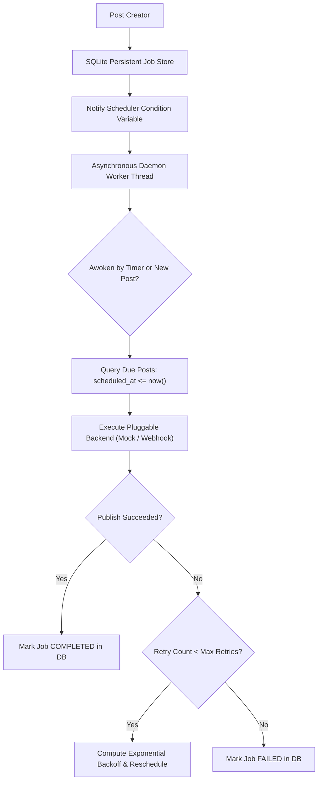

# Architecture Design: Auto-Post Scheduler

## 1. System Overview
The `Auto-Post-Scheduler` is a persistent asynchronous job scheduler utilizing an SQLite-backed job queue, a worker daemon thread synchronized with `std::condition_variable`, exponential retry backoff with jitter, and pluggable publisher backends.



## 2. Component Architecture
- **`PostDatabase`**:
  - Stores scheduled publications with columns: `id`, `topic`, `content`, `scheduled_at`, `status`, `retry_count`, `max_retries`, `last_error`.
  - ACID updates guarantee jobs are not duplicated or lost across unexpected restarts.
- **`IPostingBackend`**:
  - Pluggable interface enabling mock, file, webhook, or live social network adapters:
    ```cpp
    class IPostingBackend {
    public:
        virtual ~IPostingBackend() = default;
        virtual bool publish(const ScheduledPost& post, std::string& outErr) = 0;
    };
    ```
- **`SchedulerEngine`**:
  - Manages background thread lifecycle, graceful shutdown signals, and condition variable waits.
  - Computes exponential backoff: $t_{\text{next}} = t_{\text{current}} + \text{base} \cdot 2^{\text{retries}} + \text{jitter}$.

## 3. High Availability
- If the host system terminates abruptly, pending and in-flight jobs are recovered from SQLite upon restart.
