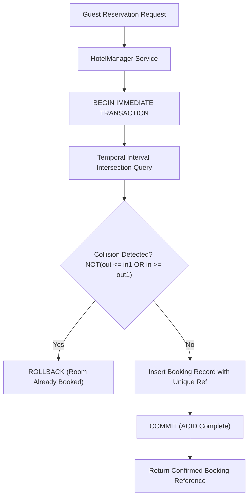

# Architecture Design: Hotel Booking System

## 1. System Overview
The `Hotel-Booking-System` is an enterprise hospitality reservation and inventory engine backed by an ACID-compliant SQLite3 relational database, temporal interval conflict detection queries, and integer-cent financial accounting.

## 2. Component Architecture
- **`IntervalCollisionDetector`**:
  - Two stay intervals $[A_{\text{in}}, A_{\text{out}})$ and $[B_{\text{in}}, B_{\text{out}})$ intersect if and only if:
    $$\neg\left(A_{\text{out}} \le B_{\text{in}} \lor A_{\text{in}} \ge B_{\text{out}}\right)$$
  - Properly supports adjacent reservations: A new guest may check in on the exact date a prior guest checks out without generating a false conflict ($A_{\text{out}} = B_{\text{in}}$).
- **`HotelDatabase`**:
  - Schema: `rooms` (room_number, type, base_price_cents, max_occupancy, status), `guests` (name, email, phone), `bookings` (booking_ref, room_id, guest_id, check_in_date, check_out_date, total_cents, status).
  - Transaction isolation (`BEGIN IMMEDIATE`) prevents concurrent double-booking race conditions.
- **`InventorySearch`**:
  - Dynamic SQL queries identifying all unoccupied rooms within any candidate date window, with optional filtering by luxury tier (`Single`, `Double`, `Suite`, `Penthouse`).

## 3. Financial & Operational Integrity
- Prices stored in 64-bit integer cents.
- Booking cancellations immediately return rooms to the available inventory pool.
