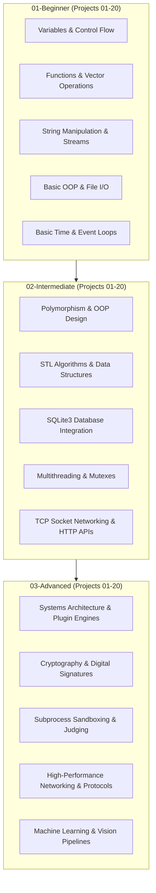

# 60 C++ Projects — Beginner to Advanced

Welcome to the **60 C++ Projects — Beginner to Advanced** repository. This is an extensive, production-grade collection of **60 completely independent C++ applications** designed to guide developers from fundamental programming concepts up to advanced systems programming, networking, concurrency, cryptography, and modern software architecture.

Every single project is standalone: it features its own `CMakeLists.txt`, comprehensive unit test suite, and dedicated documentation. There are **zero cross-project dependencies**, allowing you to build, run, and experiment with any project in isolation.

---

## 🎯 Repository Objectives

1. **Mastery of Modern C++**: Emphasize idiomatic modern C++ (C++17 baseline, selective C++20), RAII, smart pointers, `const`-correctness, and standard library facilities.
2. **Zero Shared Dependencies**: Every project can be checked out, built, and tested completely independently.
3. **Robust Quality Control**: Every project compiles cleanly with `-Wall -Wextra -Wpedantic` (GCC/Clang) or `/W4` (MSVC) and includes automated unit tests executed via `ctest`.
4. **Practical Architecture**: Practical domain modeling, deterministic error handling, and clean separation between business logic and UI/CLI boundaries.
5. **Real-world Engineering Standards**: Adherence to industry-standard formatting (`.clang-format`), defensive input validation, memory safety, and dependency management (FetchContent / vcpkg).

---

## 🗺️ Learning Progression

The curriculum is structured across three difficulty tiers of 20 projects each:



---

## 📚 Complete Project Index

### 01-Beginner (Fundamentals & Core Mechanics)
| # | Project | Description | Technologies |
|---|---|---|---|
| 01 | [01-Grade-Calculator](01-Beginner/01-Grade-Calculator/) | Calculates grade statistics, letter equivalents, and GPA distributions. | C++17, STL Vectors, IOStreams |
| 02 | [02-Digital-Clock-UI](01-Beginner/02-Digital-Clock-UI/) | Real-time digital clock display with formatted timezones and timer. | C++17, `<chrono>`, Terminal UI |
| 03 | [03-Unit-Converter](01-Beginner/03-Unit-Converter/) | Multi-category dimensional unit converter (length, mass, temperature, speed). | C++17, Functions, Precision Formatting |
| 04 | [04-Contact-Saver-CLI](01-Beginner/04-Contact-Saver-CLI/) | Contact address book with search, CSV export, and persistence. | C++17, Structs, File I/O, Streams |
| 05 | [05-Offline-Chat-App](01-Beginner/05-Offline-Chat-App/) | Turn-based simulated conversation engine with response heuristics and logging. | C++17, String tokenization, File I/O |
| 06 | [06-Library-Manager-CLI](01-Beginner/06-Library-Manager-CLI/) | Catalog and circulation manager for library books and patrons. | C++17, OOP Classes, Persistence |
| 07 | [07-Random-Quote-Generator](01-Beginner/07-Random-Quote-Generator/) | Quote retrieval and filtering engine powered by standard pseudo-random generators. | C++17, `<random>`, `<chrono>`, File I/O |
| 08 | [08-Number-Word-Converter](01-Beginner/08-Number-Word-Converter/) | Translates 64-bit integer numerals into standard English words. | C++17, String Algorithms, Recursion |
| 09 | [09-Bill-Splitter](01-Beginner/09-Bill-Splitter/) | Group expense and tip calculator with customizable tax rates and rounding rules. | C++17, Input Validation, Math Formatting |
| 10 | [10-Palindrome-Word-Checker](01-Beginner/10-Palindrome-Word-Checker/) | High-performance palindrome checker handling punctuation and casing. | C++17, `std::string_view`, Two-pointer |
| 11 | [11-Quiz-Game-UI](01-Beginner/11-Quiz-Game-UI/) | Interactive multiple-choice trivia game with question banks and scoring. | C++17, File Parsing, State Engine |
| 12 | [12-Internet-Speed-Tester](01-Beginner/12-Internet-Speed-Tester/) | Measures HTTP network throughput and latency with mock testing support. | C++17, libcurl / Sockets, `<chrono>` |
| 13 | [13-Calendar-Reminder-App](01-Beginner/13-Calendar-Reminder-App/) | Date scheduler and alert reminder application with recurring tasks. | C++17, `<chrono>`, Calendar Math |
| 14 | [14-Typing-Speed-Test](01-Beginner/14-Typing-Speed-Test/) | Tests and scores user words-per-minute (WPM), accuracy, and keystroke errors. | C++17, `<chrono>`, Levenshtein Distance |
| 15 | [15-Temperature-Converter-GUI](01-Beginner/15-Temperature-Converter-GUI/) | Interactive graphical/text UI for thermodynamic temperature conversion. | C++17, Event Handling, GUI/TUI |
| 16 | [16-BMI-Calculator](01-Beginner/16-BMI-Calculator/) | Body Mass Index calculator supporting metric/imperial systems and WHO standards. | C++17, Boundary Validation, Math |
| 17 | [17-ATM-Machine-Simulation](01-Beginner/17-ATM-Machine-Simulation/) | Banking terminal finite state machine with PIN authentication and transactions. | C++17, State Machine, Account Ledger |
| 18 | [18-Mad-Libs-Generator](01-Beginner/18-Mad-Libs-Generator/) | Humorous story template parser replacing grammatical placeholders interactively. | C++17, Regex / String Tokenizer |
| 19 | [19-Email-Format-Validator](01-Beginner/19-Email-Format-Validator/) | RFC 5322 email syntax and domain validator with detailed error diagnostics. | C++17, `<regex>`, String Parsing |
| 20 | [20-Stopwatch-Timer-GUI](01-Beginner/20-Stopwatch-Timer-GUI/) | Millisecond-accurate stopwatch with split/lap recording and UI timer display. | C++17, `<chrono>`, Event Loop |

---

### 02-Intermediate (OOP, Data Structures, Concurrency & Networking)
| # | Project | Description | Technologies |
|---|---|---|---|
| 01 | [01-File-Zipper-Tool](02-Intermediate/01-File-Zipper-Tool/) | Lossless file archiver and decompressor using Huffman coding or DEFLATE. | C++17, Binary Bitstreams, Trees |
| 02 | [02-Student-Record-Database](02-Intermediate/02-Student-Record-Database/) | Academic student record manager backed by relational SQLite database. | C++17, SQLite3 C API, Prepared Statements |
| 03 | [03-Typing-Tutor-GUI](02-Intermediate/03-Typing-Tutor-GUI/) | Structured touch-typing course tutor with error heatmaps and progress metrics. | C++17, GUI/TUI, Progress Analytics |
| 04 | [04-Group-Chat-App](02-Intermediate/04-Group-Chat-App/) | Multi-client TCP chat room server and interactive chat clients with thread pools. | C++17, Sockets, `std::thread`, Mutex |
| 05 | [05-Inventory-Manager-UI](02-Intermediate/05-Inventory-Manager-UI/) | Warehouse inventory tracking system with stock auditing and low-stock alerts. | C++17, SQLite3, Data Models |
| 06 | [06-Car-Rental-System](02-Intermediate/06-Car-Rental-System/) | Fleet vehicle rental system with reservation scheduling and fee calculations. | C++17, Polymorphism, SQLite3 |
| 07 | [07-Notes-Saver-App](02-Intermediate/07-Notes-Saver-App/) | Categorized note management tool with full-text search and export capabilities. | C++17, SQLite3 / File Storage |
| 08 | [08-Image-Filter-Tool](02-Intermediate/08-Image-Filter-Tool/) | Image processing application applying convolution filters (blur, sharpen, edge). | C++17, 2D Arrays, stb_image |
| 09 | [09-Weather-API-Fetcher](02-Intermediate/09-Weather-API-Fetcher/) | Real-time weather client querying RESTful APIs with secure env key handling. | C++17, libcurl, nlohmann/json |
| 10 | [10-Desktop-Notification-App](02-Intermediate/10-Desktop-Notification-App/) | Background daemon dispatching native desktop notifications on scheduled timers. | C++17, Platform APIs, Event Loop |
| 11 | [11-LAN-Tic-Tac-Toe](02-Intermediate/11-LAN-Tic-Tac-Toe/) | Networked two-player turn-based board game operating over local TCP sockets. | C++17, Network Protocol, Game State |
| 12 | [12-Split-Expense-App](02-Intermediate/12-Split-Expense-App/) | Group expense ledger with debt simplification graph algorithms (minimized transactions). | C++17, Graph Theory, OOP |
| 13 | [13-Resume-Builder-Tool](02-Intermediate/13-Resume-Builder-Tool/) | Form-driven resume compiler formatting structured career data into Markdown/HTML. | C++17, Templating Engine, File I/O |
| 14 | [14-PDF-Generator-App](02-Intermediate/14-PDF-Generator-App/) | Generates standard compliant PDF documents with text, lines, tables, and pages. | C++17, PDF Byte Streams, Encoding |
| 15 | [15-Quiz-Timer-App](02-Intermediate/15-Quiz-Timer-App/) | Timed examination runner with countdown timers, penalty deductions, and review. | C++17, Multithreading, State Machine |
| 16 | [16-Voice-Command-App](02-Intermediate/16-Voice-Command-App/) | Voice command parser and macro dispatcher with offline audio grammar support. | C++17, Audio Parsing, Command Pattern |
| 17 | [17-Phonebook-with-Database](02-Intermediate/17-Phonebook-with-Database/) | Relational contact address book featuring fuzzy searching and vCard import/export. | C++17, SQLite3, Fuzzy Matching |
| 18 | [18-Reminder-Alarm-App](02-Intermediate/18-Reminder-Alarm-App/) | Multi-threaded background alert scheduler playing audio alarms and logs. | C++17, `std::chrono`, Worker Threads |
| 19 | [19-Music-Player-App](02-Intermediate/19-Music-Player-App/) | Audio player application managing audio decoding, playlists, and playback state. | C++17, Audio Pipeline, miniaudio |
| 20 | [20-File-Explorer-GUI](02-Intermediate/20-File-Explorer-GUI/) | Interactive directory navigator displaying file trees, MIME types, and file sizes. | C++17, `std::filesystem`, Tree Traversal |

---

### 03-Advanced (Architecture, Concurrency, Security, AI & Systems)
| # | Project | Description | Technologies |
|---|---|---|---|
| 01 | [01-Face-Detection-App](03-Advanced/01-Face-Detection-App/) | Computer vision pipeline executing facial feature detection on raster imagery. | C++17/20, Computer Vision, OpenCV |
| 02 | [02-Java-Code-Editor](03-Advanced/02-Java-Code-Editor/) | C++ code editor providing syntax highlighting and tokenization for C Plus Plus source files. | C++17, Lexical Analysis, Text Buffer |
| 03 | [03-AI-Chatbot-Tool](03-Advanced/03-AI-Chatbot-Tool/) | Conversational assistant client communicating with LLM inference APIs with mock tests. | C++17, libcurl, JSON, Mock Testing |
| 04 | [04-Multiplayer-LAN-Game](03-Advanced/04-Multiplayer-LAN-Game/) | Authoritative server multiplayer game with packet serialization and client prediction. | C++17, High-Speed Sockets, Concurrency |
| 05 | [05-Budget-Tracker-App](03-Advanced/05-Budget-Tracker-App/) | Financial ledger with ACID persistence, category forecasts, and ASCII/SVG reporting. | C++17, SQLite3, Financial Modeling |
| 06 | [06-Custom-IDE-Plugin](03-Advanced/06-Custom-IDE-Plugin/) | Extensible host application loading dynamically linked shared plugins (`.so`/`.dll`). | C++17, Shared Libraries, ABI Contracts |
| 07 | [07-Java-Compiler-UI](03-Advanced/07-Java-Compiler-UI/) | C++ graphical frontend orchestrating compiler toolchains and analyzing C Plus Plus diagnostic output. | C++17, Process Subprocess IO, Diagnostics |
| 08 | [08-Digital-Signature-Maker](03-Advanced/08-Digital-Signature-Maker/) | Cryptographic utility generating RSA/ECDSA keys, signing files, and verifying integrity. | C++17, OpenSSL / Cryptography |
| 09 | [09-Crime-Record-Manager](03-Advanced/09-Crime-Record-Manager/) | Law enforcement record system with Role-Based Access Control and cryptographic audit trails. | C++17, SQLite3, Hash Chains, RBAC |
| 10 | [10-GPS-Location-Tracker](03-Advanced/10-GPS-Location-Tracker/) | NMEA 0183 GPS stream parser, route distance calculator, and GPX track exporter. | C++17, Stream Parsing, Geodesy Math |
| 11 | [11-Encryption-Decryption-Tool](03-Advanced/11-Encryption-Decryption-Tool/) | Cryptographic CLI for authenticated AES-256-GCM file encryption and PBKDF2 key derivation. | C++17, OpenSSL EVP / libsodium |
| 12 | [12-YouTube-Video-Downloader](03-Advanced/12-YouTube-Video-Downloader/) | HTTP streaming downloader with chunked resume and range requests for authorized content. | C++17, libcurl, Stream IO |
| 13 | [13-Cloud-Storage-App](03-Advanced/13-Cloud-Storage-App/) | Distributed client-server storage with token authentication and chunked reassembly. | C++17, Network Protocol, File Integrity |
| 14 | [14-Online-Banking-System](03-Advanced/14-Online-Banking-System/) | ACID-compliant distributed banking core with atomic transfers and concurrency control. | C++17, SQLite3, Concurrency, ACID |
| 15 | [15-OCR-Scanner-Tool](03-Advanced/15-OCR-Scanner-Tool/) | Image binarization and text extraction pipeline with optical character recognition. | C++17, Image Processing, Tesseract API |
| 16 | [16-Face-Login-Authentication](03-Advanced/16-Face-Login-Authentication/) | Biometric authentication system matching facial embedding distances against enrolled vectors. | C++17, Linear Algebra, Embeddings |
| 17 | [17-Resume-Ranker-App](03-Advanced/17-Resume-Ranker-App/) | Natural language processing engine scoring resume documents using TF-IDF and cosine similarity. | C++17, NLP, Vector Space Model |
| 18 | [18-Coding-Test-Platform](03-Advanced/18-Coding-Test-Platform/) | Automated code judging platform executing submitted code with time and memory sandboxing. | C++17, Process Control, Sandboxing |
| 19 | [19-Auto-Post-Scheduler](03-Advanced/19-Auto-Post-Scheduler/) | Distributed job scheduler with persistent priority queue, retry backoff, and webhook dispatch. | C++17, Concurrency, Priority Queues |
| 20 | [20-Hotel-Booking-System](03-Advanced/20-Hotel-Booking-System/) | Multi-room hospitality reservation engine with mutex concurrency and collision detection. | C++17, SQLite3, Thread Safety |

---

## 🚀 Quick Start Guide

### Prerequisites
- Modern C++ compiler supporting **C++17** (GCC 11+, Clang 14+, or MSVC 2022)
- **CMake 3.20+**
- **Ninja** or **Make**

### Building Any Project
To build any individual project, navigate into its folder and run standard CMake commands:

```bash
# Navigate to the chosen project directory
cd 01-Beginner/01-Grade-Calculator

# Configure build directory
cmake -S . -B build -G Ninja

# Compile
cmake --build build

# Run unit tests
ctest --test-dir build --output-on-failure

# Run application
# Windows:
.\build\GradeCalculator.exe
# Linux / macOS:
./build/GradeCalculator
```

---

## 📖 In-Depth Documentation

Detailed guides are located in the `docs/` directory:
- [C++ Setup Guide](docs/cpp-setup-guide.md) - Installing compilers, CMake, and build tools on Windows, Linux, and macOS.
- [Development Environment](docs/development-environment.md) - IDE configuration, VS Code, CLion, and debugging.
- [Project Execution Guide](docs/project-execution-guide.md) - Detailed build, execution, and troubleshooting instructions.
- [Modern C++ Coding Standards](docs/coding-standards.md) - RAII, smart pointers, naming conventions, and style rules.
- [Dependency Management](docs/dependency-management.md) - Standard library first, FetchContent, and vcpkg manifest usage.
- [Contributing Guide](docs/contributing.md) - Rules for adding features and contributing to the repository.
- [Progress Tracker](PROGRESS.md) - Real-time implementation and verification status of all 60 projects.
